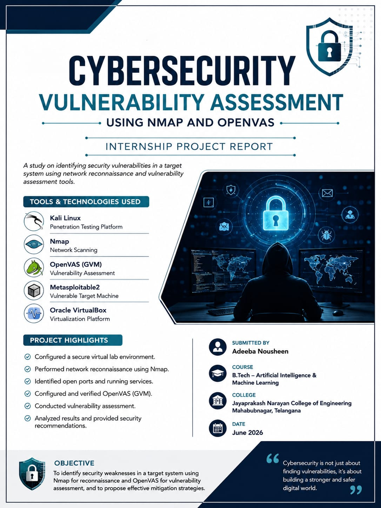
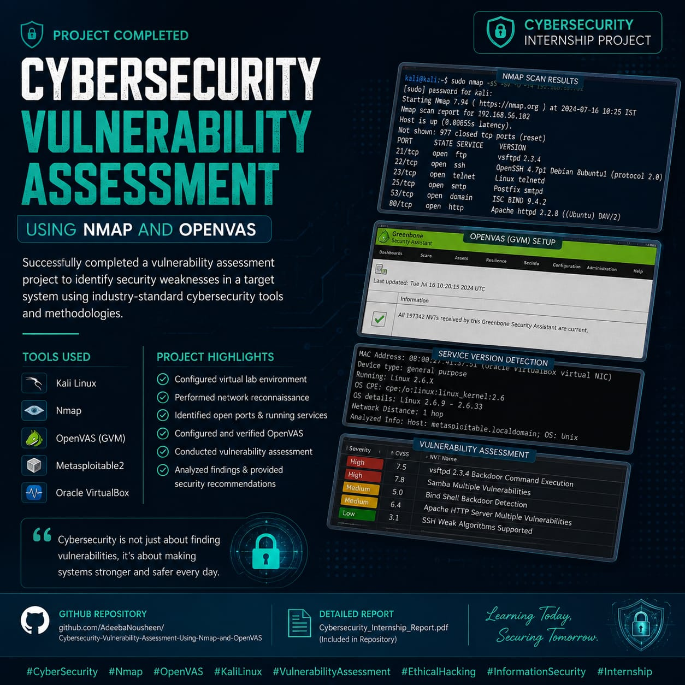
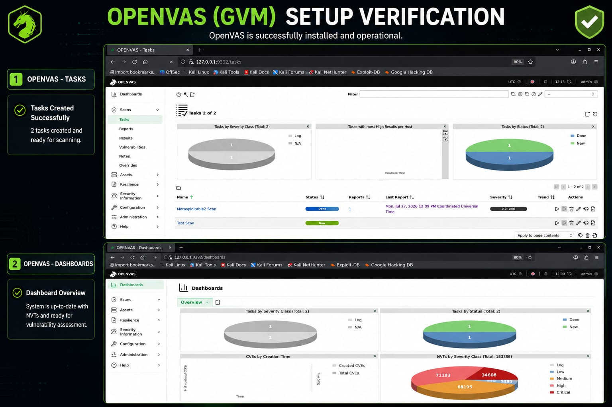
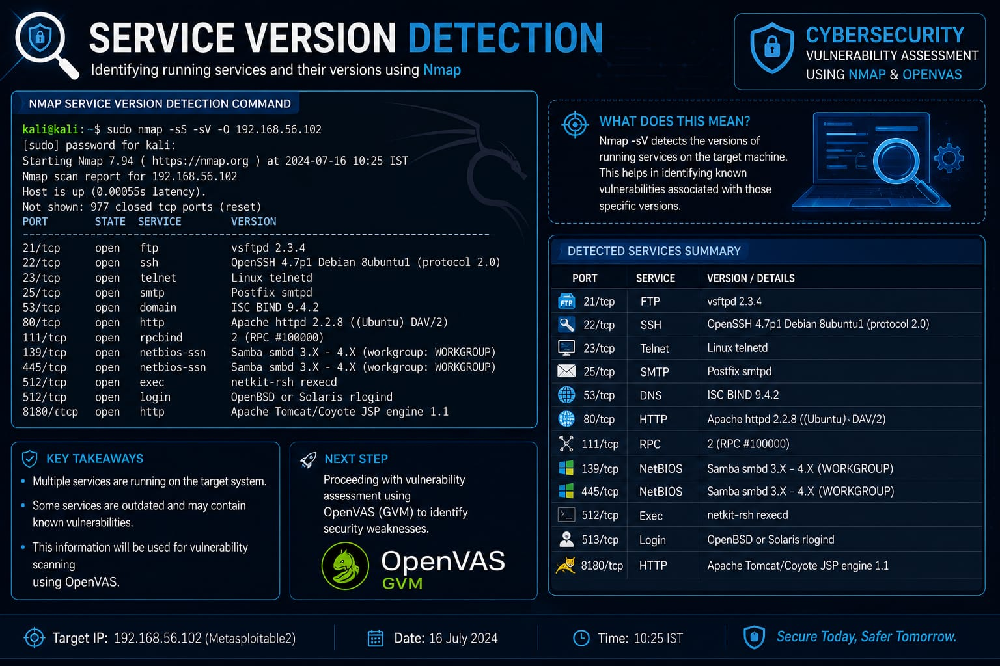
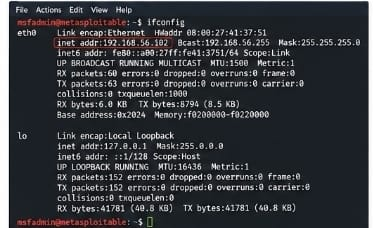

# 🛡️ Cybersecurity Vulnerability Assessment Using Nmap and OpenVAS

## 📌 Project Overview

This project demonstrates a complete cybersecurity vulnerability assessment using **Kali Linux**, **Nmap**, **OpenVAS (GVM)**, and **Metasploitable2**. The objective is to identify open ports, running services, and security vulnerabilities on a vulnerable target machine and recommend mitigation techniques.

---

## 🎯 Objectives

- Identify the target machine on the network.
- Perform network reconnaissance using Nmap.
- Detect open ports and running services.
- Configure and verify OpenVAS (GVM).
- Perform vulnerability assessment.
- Analyze security risks.
- Provide recommendations to improve system security.

---

## 🛠️ Tools Used

| Tool | Purpose |
|------|---------|
| Kali Linux | Penetration Testing |
| Nmap | Network Scanning |
| OpenVAS (GVM) | Vulnerability Assessment |
| Metasploitable2 | Vulnerable Target Machine |
| Oracle VirtualBox | Virtualization |

---

## ⚙️ Methodology

1. Configure Kali Linux and Metasploitable2 in VirtualBox.
2. Verify network connectivity.
3. Identify the target IP address.
4. Update Kali Linux packages.
5. Verify OpenVAS installation.
6. Start Greenbone Vulnerability Manager.
7. Verify PostgreSQL service.
8. Perform Nmap scanning.
9. Detect service versions.
10. Analyze vulnerabilities.
11. Recommend security improvements.

---

## 📂 Repository Structure

```text
Cybersecurity-Vulnerability-Assessment-Using-Nmap-and-OpenVAS/
│
├── README.md
├── Cybersecurity_Internship_Report.pdf
├── Metasploitable2_IP_Address.jpeg
├── updating kali packages.jpeg
├── GVM(Open VAS).jpeg
├── Starting greenbone.jpeg
├── disk spcae verification.jpeg
├── postgresql service status.jpeg
├── Nmap scan command.jpeg
├── Nmap scan results.jpeg
└── service version detection.jpeg
```

---

## 📄 Project Report

The complete internship report is available in this repository.

📑 **File:** `Cybersecurity_Internship_Report.pdf`

The report contains:

- Acknowledgement
- Abstract
- Introduction
- Objectives
- Tools Used
- Methodology
- Nmap Network Reconnaissance
- OpenVAS Vulnerability Assessment
- Vulnerability Analysis
- Recommendations
- Conclusion
- References

---

# 🌟 Professional Project Showcase

<table align="center">

<tr>

<td align="center">
<br>
<b>Project Overview</b>
</td>

<td align="center">
<br>
<b>Cybersecurity Vulnerability Assessment</b>
</td>

</tr>

<tr>

<td align="center">
<br>
<b>OpenVAS (GVM) Setup Verification</b>
</td>

<td align="center">
<br>
<b>Service Version Detection</b>
</td>

</tr>

</table>

---

# 📸 Practical Implementation Screenshots

## 1️⃣ Metasploitable2 IP Address

<p align="center">

</p>

---

## 2️⃣ Updating Kali Linux Packages

<p align="center">

</p>

---

## 3️⃣ GVM (OpenVAS) Setup Verification

<p align="center">

</p>

---

## 4️⃣ Starting Greenbone Vulnerability Manager

<p align="center">

</p>

---

## 5️⃣ Disk Space Verification

<p align="center">

</p>

---

## 6️⃣ PostgreSQL Service Status

<p align="center">

</p>

---

## 7️⃣ Nmap Scan Command

<p align="center">

</p>

---

## 8️⃣ Nmap Scan Results

<p align="center">

</p>

---

## 9️⃣ Service Version Detection

<p align="center">

</p>

---


# 📊 Scan Results

The assessment identified multiple open ports and services including:

- FTP (21)
- SSH (22)
- Telnet (23)
- SMTP (25)
- HTTP (80)
- MySQL (3306)
- PostgreSQL (5432)
- Apache Tomcat (8180)

These findings indicate several potential security risks requiring immediate attention.

---

# 🛡️ Recommendations

- Regularly update operating systems and software.
- Disable unnecessary services and ports.
- Use strong authentication and passwords.
- Restrict unauthorized access.
- Perform regular vulnerability assessments.
- Monitor systems continuously.

---

# ✅ Conclusion

This project successfully demonstrated network reconnaissance and vulnerability assessment using Kali Linux, Nmap, OpenVAS, and Metasploitable2. The identified vulnerabilities highlight the importance of regular security assessments, patch management, and continuous monitoring to improve overall system security.

---

# 📚 References

- https://www.kali.org/docs/
- https://nmap.org/docs.html
- https://greenbone.github.io/docs/latest/
- https://sourceforge.net/projects/metasploitable/

---

# 👩‍💻 Author

**Adeeba Nousheen**

B.Tech – Artificial Intelligence & Machine Learning

Jayaprakash Narayan College of Engineering

Cybersecurity Internship Project

⭐ If you found this project helpful, don't forget to Star this repository!
